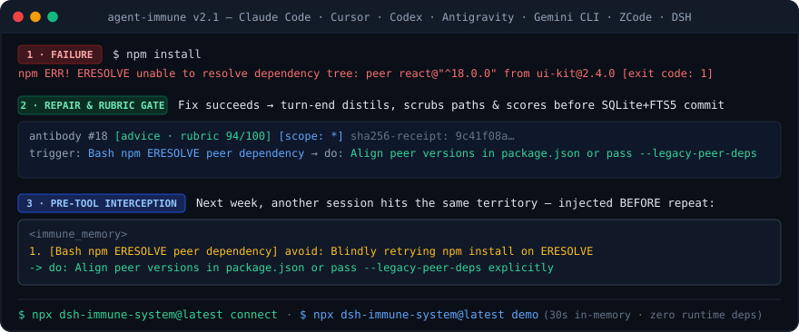
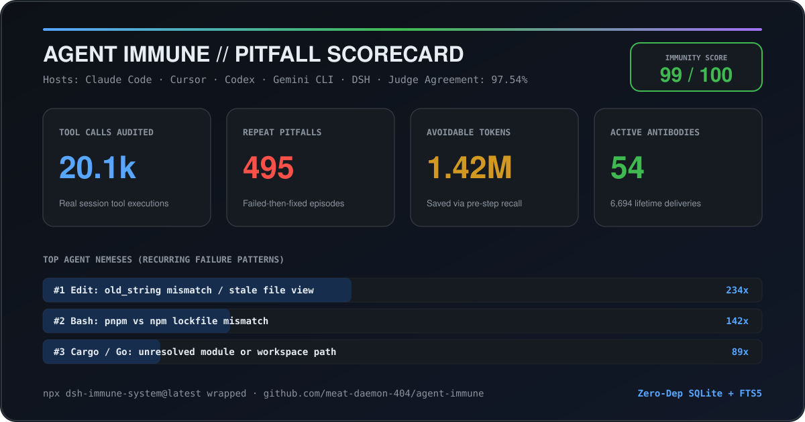
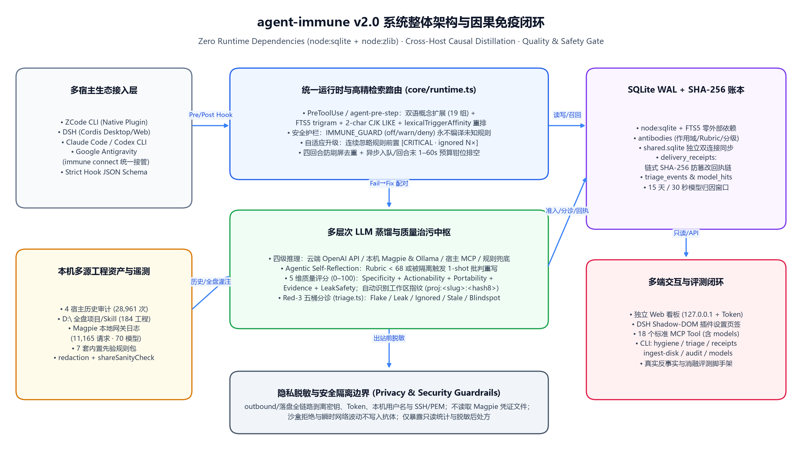
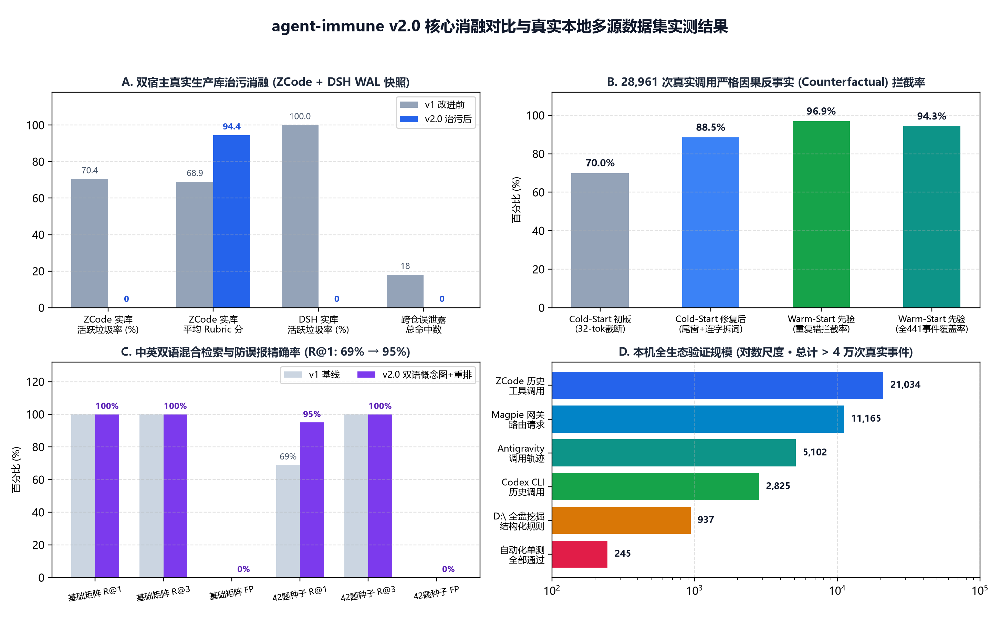

<div align="center">
  <picture>
    <source media="(prefers-color-scheme: dark)" srcset="docs/logo-dark.svg">
    
  </picture>

  <p><b>让你的 Coding Agent 别再重复调试自己已经修好的问题。</b></p>

  <p>
    <a href="https://www.npmjs.com/package/dsh-immune-system"></a>
    <a href="https://github.com/meat-daemon-404/agent-immune/actions/workflows/ci.yml"></a>
    
    
    =24">
    
    <a href="https://dsh-plugin.org/plugins/meat-daemon-404/agent-immune"></a>
  </p>

  <p>
    回放 <b>21,034 次真实工具调用</b>判定一致率 <b>97.81%</b> · <b>0</b> 假阴性 · 反事实重复错拦截 <b>Cold 88.5% / Warm 96.9%</b> · A/B 多轮二次踩坑率下降 <b>-95.0%</b>
    <br>
    <sub><a href="#跑分与持续集成">所有数字均由本机多宿主真实日志实测产出，可一键复现</a></sub>
  </p>

  <p><a href="README.md">English</a> | <b>简体中文</b></p>
</div>

**agent-immune**（npm 包名：`dsh-immune-system`）是一套**零第三方运行时依赖的 AI 编程助手避坑免疫系统**。每当一次工具调用失败、随后被修好，引擎就会将这次「踩坑 → 修复」经脱敏与五维评分后蒸馏成一条**抗体规则**（`触发场景 → 忌/错误直觉 → 宜/正确做法`），存入本地 `node:sqlite` + FTS5（含两字中文双字回退索引），并在下次即将重蹈覆辙**之前**自动注入 `<immune_memory>`。

单一 `core/` 内核同时驱动 **13 种主流开发环境与 CI/SDK 场景**：一条 `connect` 命令免插件接入 **Claude Code**、**Cursor**、**Codex CLI**、**Google Antigravity**、**Gemini CLI**、**VS Code (Copilot Agent)**、**Zed**、**Windsurf**、**Roo Code**、**Claude Desktop** 与 **Cline**；原生插件包支持 **DeepSeek Harness (DSH)** 与 **ZCode**；内置 Official MCP Registry / Smithery / Glama 三大注册表清单（`server.json`、`smithery.yaml`、`glama.json`）；并提供无状态的 **3 行 GitHub Action**、本地 `.git/hooks/pre-commit` 钩子、Git 原生零冲突团队规则同步（`.immune/rules.jsonl`）、一键生成 SVG 避坑成绩单（`immune wrapped`）以及带类型声明的 **`dsh-immune-system/core` SDK**。

<div align="center">
  
  <br>
  
  <br>
  
  <p><sub>本地回环仪表盘（`immune ui`）、可分享 SVG 避坑成绩单（`immune wrapped`）与 DSH Shadow-DOM 原生设置页 —— 100% 离线运行、零遥测，上图为演示数据。</sub></p>
</div>

## 目录

- [30 秒快速体验](#30-秒快速体验)
- [支持的 Agent 与宿主矩阵](#支持的-agent-与宿主矩阵)
- [GitHub Action：3 行接入 PR 避坑门禁](#github-action3-行接入-pr-避坑门禁)
- [避坑免疫成绩单（`wrapped`）与 Git 原生团队共享（`team-sync`）](#避坑免疫成绩单wrapped与-git-原生团队共享team-sync)
- [9 套内置种子包（54 条规则）与外部 Skill 索引](#9-套内置种子包54-条规则与外部-skill-索引)
- [历史会话体检冷启动（`audit`）](#历史会话体检冷启动audit)
- [五维质检、规则改写、去重合并与盲区覆盖率](#五维质检规则改写去重合并与盲区覆盖率)
- [CLI 命令与 21 项 MCP 工具速查表](#cli-命令与-21-项-mcp-工具速查表)
- [跑分与持续集成](#跑分与持续集成)
- [核心架构与工程细节](#核心架构与工程细节)

---

## 30 秒快速体验

**1. 纯内存跑通完整闭环**（不安装任何文件、不落盘、零网络请求）：

```bash
npx dsh-immune-system@latest demo
```

**2. 一条命令自动探测并接入本机所有已安装的编程助手**：

```bash
npx dsh-immune-system@latest connect
```

`connect` 会自动探测本机已装的宿主，将预构建引擎固定复制到 `~/.dsh-immune/`（不受 `npx` 缓存清理影响），首次修改前自动留存 `.bak-immune` 备份，幂等合并配置且绝不触碰你的其它设置。随时可用 `npx dsh-immune-system@latest connect --remove` 一键无痕卸载。

**3. 从本机已有历史记录冷启动 + 生成你的避坑成绩单**：

```bash
npx dsh-immune-system@latest audit --dry-run   # 只读扫描历史重复踩坑与可省 Token
npx dsh-immune-system@latest seed git-safety   # 安装精选防呆种子包
npx dsh-immune-system@latest wrapped           # 生成 1200x630 暗黑主题 SVG 避坑免疫成绩单
npx dsh-immune-system@latest ui                # 启动本机 127.0.0.1 仪表盘（支持中英文切换）
```

> **全局短命令别名**：执行 `npm install -g dsh-immune-system` 后可直接使用 `immune <命令>`。
> *（Windows 源码目录提示：若在本仓库根目录下直接运行 `cmd`，同名子目录 `dsh-immune-system/` 会抢先匹配；在仓库内调试请直接运行 `node dsh-immune-system/dist/zcode/src/cli.js <命令>`，用户在自己的项目目录中不受影响。）*

---

## 支持的 Agent 与宿主矩阵

| 宿主 / 环境 | 接入形态 | 一键接入命令 | 运行机制与注入通道 |
| --- | --- | --- | --- |
| **Claude Code** | 6 个生命周期 Hook 或原生插件 | `npx dsh-immune-system@latest connect claude-code` | `~/.claude/settings.json` (`hookSpecificOutput`) 或 `.claude-plugin/` |
| **Cursor** | 6 个生命周期 Hook + 旁路 MCP（20 工具） | `npx dsh-immune-system@latest connect cursor` | `~/.cursor/hooks.json` (`permission` / `agent_message`) + `~/.cursor/mcp.json` |
| **Codex CLI** | 5 个生命周期 Hook（首次需跑 `/hooks` 信任） | `npx dsh-immune-system@latest connect codex` | `~/.codex/hooks.json`（自动映射 `shell_command` / `apply_patch`） |
| **Google Antigravity** | 5 个生命周期 Hook（驼峰协议适配） | `npx dsh-immune-system@latest connect antigravity` | `~/.gemini/config/hooks.json`（`SessionStart` / `UserPromptSubmit` / `PreInvocation` / `PostToolUse` / `Stop`） |
| **Gemini CLI** | 5 个生命周期 Hook | `npx dsh-immune-system@latest connect gemini-cli` | `~/.gemini/settings.json`（`BeforeAgent` / `BeforeTool` / `AfterTool` / `AfterAgent`） |
| **Windsurf / Roo Code / Cline / Claude Desktop** | MCP Server（21 工具） | `npx dsh-immune-system@latest connect <host>` | 自动接入 Windsurf、Roo Code、Cline 与 Claude Desktop 配置 |
| **VS Code / Zed** | 原生 MCP / Context Server（21 工具） | `npx dsh-immune-system@latest connect vscode` / `zed` | `Code/User/mcp.json`（`servers`） · `zed/settings.json`（`context_servers`） |
| **MCP 官方及主流注册表** | 标准注册表元数据清单 | `server.json` · `smithery.yaml` · `glama.json` | `io.github.meat-daemon-404/agent-immune`（`npx -y dsh-immune-system@latest mcp`） |
| **自定义 Node/TS Agent** | 零依赖强类型 SDK | `import { ImmuneRuntime } from 'dsh-immune-system/core'` | 自带完整 `.d.ts` 类型声明（`./dist/core/index.d.ts`） |
| **DeepSeek Harness (DSH)** | 原生 Cordis 插件包 + Shadow-DOM 设置页 | `dsh plugin --profile <profile> add dsh-immune-system` | `agent/session-start`、`pre-step`、`tools/post-execute`、`turn-stopping`（兼容 DSH 0.2.2+ v4 消息源） |
| **ZCode** | 原生插件市场源 + 斜杠命令 + MCP | `zcode plugins marketplace add meat-daemon-404/agent-immune` | `.zcode-plugin/plugin.json` + `/immune*` 斜杠命令 |

<details>
<summary><b>展开查看 DSH / ZCode 原生安装说明与通用 MCP 配置</b></summary>

**DeepSeek Harness (DSH)**：
```bash
dsh plugin --profile <profile> add dsh-immune-system
# 或通过 tarball / GitHub 安装：
cd dsh-immune-system && npm pack
dsh plugin --profile <profile> add ./dsh-immune-system-<version>.tgz
dsh plugin --profile <profile> add github:meat-daemon-404/agent-immune
```
*（`github:` 安装方式会触发 `prepare` 编译；pnpm 10 默认拦截构建脚本，需先执行 `pnpm approve-builds` 放行 `dsh-immune-system`，直接从 npm 或 tarball 安装则无需编译。安装后请重启 DSH。）*

**ZCode**：
```bash
node "<zcode.cjs>" plugins marketplace add meat-daemon-404/agent-immune
node "<zcode.cjs>" plugins install dsh-immune-system@dev-dsh-plugin-immune
```

**任意其它 MCP 客户端**（纯标准输入输出，零外部依赖）：
```json
{
  "mcpServers": {
    "dsh-immune-system": {
      "command": "npx",
      "args": ["-y", "dsh-immune-system@latest", "mcp"]
    }
  }
}
```
</details>

---

## GitHub Action：3 行接入 PR 避坑门禁

用 `immune sync-doc` 将本仓库验证过的抗体同步进 `AGENTS.md` 或 `CLAUDE.md` 后，无需任何云端数据库即可在 GitHub Pull Request 中自动巡检新增代码：

```yaml
# .github/workflows/pitfall-check.yml
name: Pitfall Check
on: [pull_request]
jobs:
  immune:
    runs-on: ubuntu-latest
    steps:
      - uses: actions/checkout@v4
      - uses: meat-daemon-404/agent-immune@main
```

- 自动解析 `+++ b/<file>` 与 `@@ +line @@` 行号，在 PR 代码行直接输出 **GitHub 精准行级批注（Annotations）** 并生成 **$GITHUB_STEP_SUMMARY** 汇总表。
- 自动跳过 `<!-- immune:generated -->` 托管块自身的变更，更新文档绝不自摆乌龙。
- 严格遵守命令行参数边界（例如 `--force` 规则只会拦截 `git push --force`，绝不误伤建议写法 `git push --force-with-lease`）。如需仅提示不阻断流水线，传入 `fail-on-findings: 'false'` 即可。
- **想要本地提交前即时拦截？** 运行 `immune git-hook --install`（或附加 `--warn-only`）即可向 `.git/hooks/pre-commit` 无损注入 `< 40 ms` 的暂存区巡检片段，与现有的 Husky / lint-staged 和平共存（`immune git-hook --remove` 一键卸载）。

---

## 避坑免疫成绩单（`wrapped`）与 Git 原生团队共享（`team-sync`）

### 一键生成 1200×630 SVG 避坑免疫成绩单（`immune wrapped`）
零第三方依赖渲染一张可直接嵌入 GitHub README 或社交平台分享的暗黑主题 SVG 成绩单，直观展示生效抗体数、累计事前拦截次数、节省的无效重试 Token、Top 3 高频宿敌坑点以及 `0–100` **免疫评分（Immunity Score）**：

```bash
immune wrapped                                 # 默认输出 ./immune-wrapped.svg
immune wrapped ./assets/scorecard.svg          # 指定输出路径
immune wrapped --json                          # 以 JSON 格式输出免疫分与统计详情
```

### Git 原生零冲突团队免疫记忆（`immune team-sync` / `.immune/rules.jsonl`）
二进制 `.sqlite` 无法在多人 Git 分支间直接合并。`immune team-sync` 将验证过的成熟规则按 `sha256(prescription)` 确定性哈希排序序列化为 `.immune/rules.jsonl`（多人不同分支新增规则合并零冲突），并内置 `isTeamShareSafe()` 自动过滤本机目录路径、邮箱与密钥：

```bash
immune team-sync                               # 导出本仓安全规则至 .immune/rules.jsonl
immune team-sync --min-hits 3                  # 仅导出命中 >= 3 次的高置信度规则
immune team-sync --import                      # 将仓库已提交的 .immune/rules.jsonl 合并进本地 SQLite
```

---

## 9 套内置种子包（54 条规则）与外部 Skill 索引

九套由维护者手工编写的高频工程防呆包（与内置通用教训同级，**绝非**未经审核的模型输出），走标准去重合并通道安装：

| 种子包 ID | 规则数 | 覆盖痛点 |
| --- | --- | --- |
| `git-safety` | 6 | 强推防护（`--force-with-lease`）、`reset --hard`、`clean -fd`、`commit -F`、测试假凭据防拦截 |
| `node-ts` | 6 | `node:sqlite` 版本门槛、ESM `.js` 扩展名、Windows `pathToFileURL`、`ERESOLVE`、WAL 安全备份 |
| `python-uv` | 6 | `uv run` 环境隔离、PEP 668 系统 Python 保护、`pytest -s`、可变默认参数陷阱 |
| `rust-cargo` | 6 | 借用检查器可变别名冲突（`E0502`）、跨 `.await` 的 `Send` 约束、阻塞 Tokio 线程、Workspace 特性漂移 |
| `go-mod` | 6 | 带类型 `nil` 接口陷阱、`go mod tidy` 校验、`-race` 并发 Map 写崩溃、`errgroup` 上下文取消 |
| `docker` | 6 | BuildKit 缓存挂载、`.dockerignore` 构建上下文膨胀、`127.0.0.1` 容器监听陷阱、Alpine `musl` 兼容 |
| `modern-web` | 6 | `<dialog>`、Popover、`100dvh`、CSS 锚点定位、View Transitions（自动识别浏览器 Baseline 兼容级别！） |
| `dsh-ecosystem` | 6 | Cordis `inject` 服务声明、Waterfall 非零退出判定、Shadow-DOM 插件样式隔离 |
| `patrol-triage` | 6 | Red-3 反腐蚀根因分诊、工作区作用域锁、先 Read 后 Edit 铁律 |

```bash
immune seed                                    # 查看全部 9 套种子包及当前项目识别到的 Baseline
immune seed rust-cargo                         # 安装指定种子包
immune seed modern-web --baseline widely       # 仅安装广泛兼容（Widely available）子集
immune seed rust-cargo --remove                # 保守卸载（已被实战命中的规则会自动保留！）
```

全部 54 条内置种子规则均受 CI `scripts/bench-seed-recall.mjs` 门禁守护（当前 **54/54 在 R@1 = 100%，R@3 = 100%，误报率 0%**）。

**按需索引大型外部 `SKILL.md` 与全盘工程资产（零静态上下文占用）**：
```bash
immune ingest-skill ./path/to/SKILL.md --pack team-playbook
immune ingest-disk D:/Projects --max-depth 3   # 批量扫描本地仓库与 SKILL.md 脱敏入库
```

---

## 历史会话体检冷启动（`audit`）

刚安装时库是空的。`immune audit` 会流式回放本机已有的 **ZCode** 会话库、**Codex CLI** 记录（`~/.codex/sessions`）、**Claude Code** 转录（`~/.claude/projects`，含嵌套子代理转录）以及 **Google Antigravity** 轨迹日志（`~/.gemini/antigravity/brain/*/.system_generated/logs/transcript.jsonl`）：

```bash
immune audit --dry-run                 # 只读生成踩坑体检报告：按工具统计失败、高频重复坑点与可省 Token
immune audit --days 30 --max 25        # 将历史经验入队蒸馏成你的首批抗体（配置了 LLM 则自动走模型）
```

---

## 五维质检、规则改写、去重合并与盲区覆盖率

### 五维入库质量门禁与工作区严格隔离（`v2.1`）
每条候选规则入库前均按 **具体性、可执行性、可移植性、证据强度、防泄漏安全性** 进行 `0–100` 评分（`core/rubric.ts`、`core/hygiene.ts`）：
- **`advice`（全局通用建议，`project_scope = '*'`）**：经模型或人工提炼的跨项目工程准则（纯确定性命令回声在结构上严禁进入全局作用域，彻底杜绝跨仓库串味）。
- **`tactic`（项目专属战术，`proj:<slug>:<hash8>`）**：绑定项目目录指纹，仅在该项目工作区内召回注入。
- **`quarantined`（自动隔离）**：原始 `tool=` 包装文本、绝对路径文件写入、内联 JS/Python 代码块、音视频上传指令或一次性只读探针（`ls`/`grep`/`cat`）直接拦截隔离。旧版数据库可运行 `immune hygiene` 一键自愈。

### 把命令转储升级成精炼建议（`immune rewrite`）
不配大模型时，确定性路径会忠实记录修好问题的那条命令。你可以通过两种方式将命令转储升级为一句话建议：
- **配置云端 API / 本地 Magpie / Ollama**：运行 `immune rewrite --dry-run` → `immune rewrite --max 5`（标记 `prescription_source = 'llm'`）。
- **零 API Key（借用宿主大模型 MCP 自省）**：让当前连接了 MCP 的 Agent 调用 `immune_rewrite_candidates` 读取待改写规则，并调用 `immune_rewrite_apply` 写回（标记 `prescription_source = 'host_llm'`）。

### 近似规则合并、盲区覆盖率、Red-3 分诊与 WAL 安全备份
```bash
immune consolidate --dry-run       # 预览同症状、同工具且处方相似度 >=70% 的可合并规则对
immune coverage --days 30 --top 8  # 区分历史错误：已知（known）、仍在注入（still injected）与真盲区（uncovered）
immune triage                      # 查看 Red-3 注入后失败五桶分诊（网络抖动 / 跨仓串台 / 模型无视 / 过期建议）
immune receipts                    # 校验防篡改 SHA-256 投递回执哈希链与按模型统计的节省收益
immune models                      # 各模型规则存活率矩阵 + 本机 Magpie 网关只读遥测关联
immune backup                      # WAL 安全热备份（直接 cp 复制 WAL 模式下的 SQLite 可能得到 0 行空库！）
immune export 5 ./SKILL.md         # 经隐私闸门脱敏导出高命中规则（自动阻断含路径/邮箱/密钥的条目）
immune sync-doc                    # 将成熟规则同步写入 AGENTS.md（或已存在的 CLAUDE.md）托管块
```

---

## CLI 命令与 21 项 MCP 工具速查表

随时可运行 `immune --help` 或 `immune <子命令> --help` 查看详细参数（只读与巡检命令均支持 `--json` 机器可读输出）。

<details>
<summary><b>展开查看全部 29 个 CLI 子命令</b></summary>

| 分类 | 命令 | 作用 |
| --- | --- | --- |
| **快速上手与宿主连接** | `immune demo` | 在内存中演示完整的「失败 → 蒸馏评分 → 异构提问召回 → `<immune_memory>`」闭环 |
| | `immune connect [host] [--status\|--refresh\|--remove] [--json]` | 一键接入或卸载 11 类外部编程助手（省略 `host` 自动探测本机环境） |
| | `immune git-hook [--install\|--remove\|--status] [--warn-only]` | 无损安装或卸载 `.git/hooks/pre-commit` 本地提交前避坑巡检钩子 |
| | `immune completions <bash\|zsh\|fish\|powershell>` | 输出终端 Tab 自动补全脚本（支持 `immune` 与 `dsh-immune-system`） |
| | `immune doctor [--json]` | 自检 Node/FTS5、双库状态、固定安装位钩子路径、UI 契约、预算钳位与规则卫生 |
| | `immune ui [--port 7788]` | 启动本地离线回环仪表盘（含「召回模拟器」、中英双语切换） |
| **抗体库管理与同步** | `immune list [--all] [--json]` | 查看当前生效（或含已退役/隔离）的抗体列表、评分与作用域 |
| | `immune search <query>` | 只读搜索（不虚增命中计数） |
| | `immune explain "<query>" [--tool T] [--limit N] [--json]` | 只读「召回模拟器」：查看概念图谱扩展、打分拆解与注入预览 |
| | `immune learn <trigger> [symptom] <prescription>` | 直接写入人工确认的经验规则（`prescription_source = 'human'`） |
| | `immune forget <id> \| --last \| --prune [days]` | 删除指定规则（完整保留只追加 SHA-256 回执链）或清理长期零命中僵尸规则 |
| | `immune stats [--json]` | 查看规则分布、抑制重复带来的可省 Token 估算、模型归因与睡眠评审簇 |
| | `immune wrapped [out.svg] [--hosts H] [--stdout] [--json]` | 生成 1200×630 暗黑主题 SVG 避坑免疫成绩单与 `0–100` 免疫分 |
| | `immune team-sync [file] [--import] [--min-hits N] [--json]` | 导出或导入 Git 原生按哈希确定性排序的 `.immune/rules.jsonl` 团队共享规则 |
| | `immune export [min_hits] [out.md]` | 将验证过的抗体经隐私闸门导出为 `SKILL.md` |
| | `immune export-json [out.json]` / `import-json <in.json>` | 导出或导入可迁移 JSON 规则快照（强制执行 `shareSanityCheck`） |
| | `immune sync-doc [--out FILE] [--min-hits N]` | 将成熟规则同步至 `AGENTS.md`（若仅存在 `CLAUDE.md` 则自动对齐） |
| | `immune ci-check [--diff FILE] [--doc FILE] [--github] [--warn-only] [--json]` | 无状态扫描 Git Diff 风险行，支持 GitHub PR 行级批注与 Step Summary |
| | `immune backup [dest.sqlite]` | 调用 `node:sqlite` 原生备份接口穿过 WAL 写出一致快照 |
| **冷启动与知识摄入** | `immune seed [pack] [--baseline widely\|newly] [--remove] [--json]` | 列出、安装或保守卸载 9 套内置防呆种子包 |
| | `immune audit [--dry-run] [--days N] [--max N] [--source S] [--json]` | 回放 ZCode / Codex / Claude Code / Antigravity 历史日志生成体检报告与蒸馏任务 |
| | `immune ingest-skill <path> [--pack P] [--baseline B] [--remove]` | 将外部 `SKILL.md` 或规范文档按章节/表格索引进 FTS5 |
| | `immune ingest-disk [roots...] [--max-depth N] [--dry-run]` | 扫描指定磁盘目录树下的工程规范与技能资产并脱敏入库 |
| **质量治理与遥测** | `immune hygiene [--dry-run] [--json]` | 执行五维评分、路径抽象、工作区作用域加锁与噪声隔离修复 |
| | `immune rewrite [--dry-run] [--max N] [--id a,b]` | 调用所配模型将命令行转储改写为精炼建议 |
| | `immune consolidate [--dry-run] [--json]` | 合并同课近似规则，无损继承触发词、命中计数与多模型归因 |
| | `immune coverage [--days N] [--top K] [--json]` | 审计宿主近期真实报错的规则覆盖率与未覆盖盲区簇 |
| | `immune triage [--limit N] [--json]` | 查看 Red-3 注入后失败五桶分诊详情 |
| | `immune receipts [--limit N] [--json]` | 校验 SHA-256 投递回执哈希链完整性与节省统计 |
| | `immune models [--json]` / `workspaces [--json]` / `detours [--json]` | 模型免疫存活矩阵（含 Magpie 遥测）、已登记工作区画像与 4+ 次探测弯路记录 |
</details>

<details>
<summary><b>展开查看全部 21 项 MCP Server 工具</b></summary>

| MCP 工具名 | 功能说明 |
| --- | --- |
| `immune_match` | 针对当前任务检索匹配抗体并记录投递回执 |
| `immune_list` | 只读浏览抗体库（绝不虚增命中计数） |
| `immune_learn` | 写入人工或 Agent 确认的经验规则（`prescription_source = 'human'`） |
| `immune_forget` | 按 ID 或 `--last` 删除规则 |
| `immune_status` | 激活或退役指定规则 |
| `immune_stats` | 读取库健康度、隔离计数、模型归因与节省 Token 统计 |
| `immune_export` | 经隐私安全门禁导出成熟规则 Markdown |
| `immune_audit` | 只读扫描本机多宿主会话历史并生成踩坑报告 |
| `immune_seed_packs` | 查询或安装 9 套内置种子规则包 |
| `immune_ingest_skill` | 按需索引或移除外部 `SKILL.md` / Markdown 指南 |
| `immune_rewrite_candidates` | 获取待改写的回声级命令规则与严格改写契约（供无 API Key 宿主自省改写） |
| `immune_rewrite_apply` | 提交经守卫校验的宿主改写结果（`prescription_source = 'host_llm'`） |
| `immune_hygiene` | 预览或执行五维质量清洗与作用域修复 |
| `immune_triage` | 查询 Red-3 五桶因果分诊统计 |
| `immune_receipts` | 校验 SHA-256 投递回执链完整性与 ROI |
| `immune_workspaces` | 列出已索引工作区作用域、技术栈与规则数 |
| `immune_ingest_disk` | 扫描指定工作区目录提取规范与技能规则 |
| `immune_models` | 查询跨模型规则存活矩阵与本地 Magpie 网关流量摘要 |
| `immune_doctor` | 执行完整的运行环境、SQLite FTS5、钩子路径与规则卫生体检 |
| `immune_ci_check` | 无状态扫描 Git Diff 是否触碰仓库 `AGENTS.md` / `CLAUDE.md` 已登记坑点 |
| `immune_explain` | 只读召回模拟器：实时返回概念图谱扩展、多维打分拆解与 `<immune_memory>` 注入预览 |
</details>

---

## 跑分与持续集成

每次提交与 PR 均在 **Linux（Node 22 & 24）** 与 **Windows（Node 24）** 双平台矩阵运行门禁：

- **失败判定真值回放**（`scripts/eval-judge.mjs`）：回放 **21,034 次带宿主标注的真实工具调用**，判定一致率 **97.81%**，**0 假阴性**；`2.19%`（`461` 次）假阳性全部为「非零退出即预期答案」的只读探针命令，由探针免疫与 Red-3 分诊在下游安全隔离（详见 [AGENTS.md](AGENTS.md) 决策 #25）。
- **自动化单测与多宿主契约验证**：**`266 / 266` 项单测与集成测试全绿**（`npm test`）、**`42 / 42` 项多宿主真实子进程 Hook 端到端断言**（覆盖 Claude Code、Codex、Antigravity、Gemini CLI 与 Cursor，`scripts/verify-connected-runtime.mjs`）、**`20 / 20` 项真实 Cordis 事件总线断言**（`scripts/verify-live-host.mjs`）、**`7` 份清单 `10` 个版本字段一致性门禁**（`scripts/check-versions.mjs`），以及 **`100%` 源码与构建产物 1:1 静态导入图校验**（`scripts/verify-dist-integrity.mjs`）。
- **中英双语召回与 9 包内容门禁**：`scripts/bench-recall.mjs` 达 **R@1 100%、R@3 100%、误报 0%**；覆盖全部 **54 条内置种子规则**的 `scripts/bench-seed-recall.mjs` 达 **R@1 100%（54/54）、R@3 100%（54/54）、误报 0%（0/9）**。
- **索引规模与热路径延迟**（`scripts/bench-scale.mjs`、`scripts/bench-tool-latency.mjs`）：300 条规则入库仅需 `60 ms`（`0.20 ms/条`），检索延迟 `p50 = 0.60 ms`、`p95 = 1.20 ms`；工具执行路径零模型调用（中位延迟 `1.8 ms`），蒸馏统一在回合末 `1–60 s` 预算钳位内批量排空。
- **严格因果反事实拦截回放**（`scripts/bench-ablation.mjs`）：在 **28,961 次真实多宿主调用**上按时间顺序严格前向重放，零先验 **Cold-Start 提前拦截 88.5%（115/130）** 的重复错误；预热内置包与本地资产后 **Warm-Start 拦截率达 96.9%（126/130）**，全错误覆盖率 **94.3%**。
- **端到端 A/B 多轮模拟对比基准**（`node scripts/bench-ab-simulation.mjs`）：在 **10 类真实高频踩坑场景 × 3 轮会话（共 30 轮）** 上对比无免疫与启用 `agent-immune` 的端到端表现：

| 评测指标（10 类场景 × 3 轮 = 30 轮会话） | 对照组 Control（无免疫记忆） | 实验组 Treatment（启用 `agent-immune`） | 实测提升幅度 |
| --- | --- | --- | --- |
| **工具调用总失败次数** | `30` | **`11`** | **`-63.3%`** |
| **第 2/3 轮二次重复踩坑次数** | `20` | **`1`** | **`-95.0%`** |
| **失败与重试消耗 Token 总量** | `130,800` | **`50,520`** | **`-61.4%`（净省 `80,280` tokens）** |
| **工具前 FTS5 召回延迟（`p50`）** | — | **`0.008 ms`** | 热路径零大模型调用 |

### 与同类工具的定位对比

| 维度 | **agent-immune** | [deja-vu](https://github.com/vshulcz/deja-vu) | [mem0](https://github.com/mem0ai/mem0) | [claude-memory-compiler](https://github.com/nicobailon/claude-memory-compiler) |
| --- | --- | --- | --- | --- |
| **存什么** | 经五维评分的「失败 → 修复」抗体 + SHA-256 回执链 | 完整会话记录原文 | 对话事实片段 | 编译后的静态 Skill 文件 |
| **怎么生效** | Hook 在重蹈覆辙前主动注入 + PR GitHub Action | 需要主动搜索（MCP/TUI） | SDK 接口调用 | 依赖模型主动读取 |
| **防腐烂与隔离** | 五维评分 + 工作区隔离 + Red-3 五桶因果分诊 | 无（原样检索） | 向量覆盖 | 手动重编译 |
| **团队 Git 同步** | 哈希确定性排序 `.immune/rules.jsonl` + `AGENTS.md` | 仅本机 | 云端/向量库 | 本地文件 |
| **运行时依赖** | **零依赖**（Node 内置 `node:sqlite` FTS5） | Go 二进制 | Python + 向量库 | Node 第三方依赖 |
| **覆盖环境** | Claude Code、Cursor、Codex、Antigravity、Gemini CLI、VS Code、Zed、Windsurf、Roo Code、Cline、DSH、ZCode、GitHub Actions、TS SDK | Claude Code、Codex、Cursor 等 | 自定义 SDK 应用 | Claude Code |

---

## 核心架构与工程细节

<div align="center">
  
  <br>
  
</div>

- **失败靠自己判，不轻信 `isError`**：DSH 与 ZCode 中命令非零退出均不会抛异常。判定器严格按「结构化 `exitCode` → `isError` → 尾部退出码/信号/超时标记 → 窄特征词」分级判定；带非空结构化载荷但无退出码的结果一律视为成功且不扫正文，读取含 `Error:` 的日志文件绝不误判。
- **同目标配对与探针免疫**：失败仅与同一文件或同一命令族（`npm`/`npx`/`pnpm`、`cargo`、`go`）的后续成功配对；只读探针（`ls`、`cat`、`git status`、`grep`）及权限拒绝（`sandboxDenied`、`UPLOAD_NEEDS_PERMISSION`）绝不污染规则库。
- **渲染层标签逃逸隔离**：所有宿主通道在渲染注入块时均强制剥离 `<` 与 `>`，恶意或畸形报错输出绝无可能提前闭合 `</immune_memory>`。
- **确定性高危护卫**：`IMMUNE_GUARD=off|warn|deny`（默认 `off`）仅由源码中带反误伤测试矩阵的确定性规则驱动，绝不将模型输出编译为拦截正则。*（注：`IMMUNE_GUARD=warn` 仅在支持上下文提示的 Hook 宿主生效；DSH 的 `PreToolDecision` 无纯提醒通道，开启后会执行拦截。）*
- **可选大模型配置**：默认离线可用；如需启用云端 OpenAI 兼容端点、本地 Magpie 网关（`127.0.0.1:3425/v1`）或本地 Ollama（`127.0.0.1:11434/v1`），详见 [`.env.example`](.env.example)。

延伸阅读：[V2 架构白皮书](docs/ARCHITECTURE-V2.md) · [评测与消融实验报告](docs/EVALUATION.md) · [版本更新日志](CHANGELOG.md) · [42 条核心工程不变量 (`AGENTS.md`)](AGENTS.md) · [贡献指南](CONTRIBUTING.md) · [安全策略](SECURITY.md).
