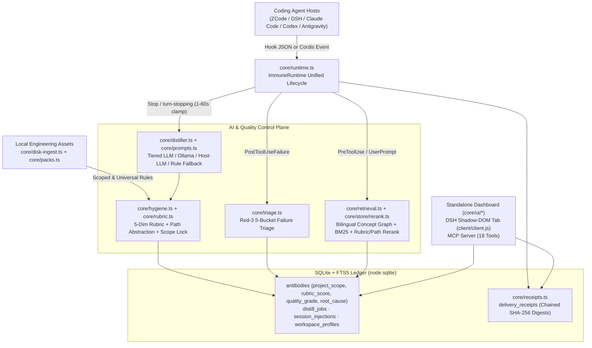

# Architecture V2 — Self-Evolving Coding Agent Immune System (`dsh-immune-system@2.0.0`)

`dsh-immune-system` (`agent-immune`) is a zero-runtime-dependency (`node:sqlite` built-in only) self-evolving memory and safety runtime for coding agents (**DSH**, **ZCode**, **Claude Code**, **Codex CLI**, and **Antigravity**). Rather than storing raw conversation transcripts, it turns *failed → fixed* tool episodes and local engineering invariants into scoped, scored **antibodies** (`trigger → avoid → prescription`), verifies their downstream outcome via **Red-3 triage** and **SHA-256 delivery receipts**, and injects only high-signal warnings before the agent repeats a mistake.

---

## 1. Motivation & Diagnosis of v1 Limitations

Inspecting a live production database (`57` rules, `12,332` cumulative deliveries across `6` models) exposed four architectural bottlenecks in v1:

1. **Echo-noise pollution (`66.7%` active rules)**: Deterministic fallback stored raw tool dumps (`Write: D:\...`, raw JSON stdout blobs, ad-hoc `grep`/`dir` probes) as "prescriptions".
2. **Global cross-project leakage**: A shared SQLite DB lacked `project_scope`, causing repo-specific dumps to surface in unrelated repositories (`6` cross-repo leaks per 4-query probe sweep).
3. **Host adapter duplication & monolithic modules**: State-machine orchestration was duplicated between `dsh/src/index.ts` and `zcode/src/hooks/*.ts` + `drain.ts`; UI, CLI, and history audit lived in monolithic files (`~900–1,100` lines each).
4. **History-scan hangs on large host DBs**: Scanning a `3.7 GB` ZCode session SQLite DB walked JSON overflow pages (`json_extract`), while Windows UNC/protocol-relative strings (e.g. `//registry.npmjs.org/...`) inside trace texts triggered blocking SMB lookups in `selfnoise.ts`.

v2 resolves all four while keeping zero external runtime dependencies and 100% compatibility with strict hook schemas and offline loopback/Shadow-DOM dashboards.

---

## 2. System Architecture



### Module Map

| Layer | Modules | Responsibility |
| --- | --- | --- |
| **Unified Runtime** | `core/runtime.ts`, `zcode/src/hooks/*.ts`, `dsh/src/index.ts` | Single lifecycle state machine (`prepareSessionStart`, `primeSession`, `userPrompt`, `preToolUse`, `postToolUse`, `drain`), shared `clampBudgetMs` (`1–60 s`). |
| **Quality & Isolation** | `core/rubric.ts`, `core/hygiene.ts`, `core/similarity.ts` | 5-dimension rubric (`0–100`), root-cause taxonomy (`8` labels), `<repo>`/`<path>` path abstraction, same-scope similarity guard, `repairLibraryHygiene()`. |
| **Failure Triage & Audit** | `core/triage.ts`, `core/receipts.ts`, `core/coverage.ts` | Red-3 5-bucket triage before blaming rules; chained SHA-256 delivery/outcome receipts for tamper detection & per-model ROI. |
| **Hybrid AI & Retrieval** | `core/llm.ts`, `core/prompts.ts`, `core/distiller.ts`, `core/retrieval.ts`, `core/host-rewrite.ts`, `core/model-intel.ts` | Cloud OpenAI-compatible API, local Magpie gateway (`IMMUNE_MAGPIE_MODEL`) / Ollama (`IMMUNE_OLLAMA_MODEL`), Agentic rubric self-reflection critique (`CRITIQUE_DISTILL_PROMPT`), MCP `host_llm`, 19 bilingual concept edges + `lexicalTriggerAffinity` rerank (`R@1 95%`), and adaptive salience escalation (`[CRITICAL · ignored N×]`). |
| **Knowledge & Telemetry** | `core/disk-ingest.ts`, `core/packs.ts`, `core/prewarm.ts`, `core/audit/{logs,magpie,report,types,zcode}.ts` | Whole-disk repo/skill/AGENTS.md ingestion, 7 builtin packs (`dsh-ecosystem`, `patrol-triage`, etc.), fast streaming 4-host audit, and Magpie gateway telemetry scanner (`usage.jsonl` + `routing/*.jsonl.gz`). |
| **Surfaces & Interfaces** | `zcode/src/cli.ts`, `zcode/src/commands/*`, `zcode/src/mcp-server.ts`, `core/ui/{labels,styles,template,client-script,page,query,server}.ts`, `dsh/src/ui-route.ts`, `dsh-immune-system/client/client.js` | Modular CLI router (`hygiene`, `triage`, `receipts`, `models`, `workspaces`, `ingest-disk`), 18 MCP tools, loopback token-gated dashboard + Shadow-DOM DSH web tab. |

---

## 3. Core Lifecycle Sequence

```mermaid
sequenceDiagram
    participant Agent as Coding Agent
    participant Hook as Hook / Cordis Adapter
    participant RT as ImmuneRuntime
    participant Store as SQLite + FTS5 + Receipts

    Agent->>Hook: PreToolUse (toolName, toolInput, cwd)
    Hook->>RT: preToolUse(...)
    RT->>Store: expandConceptQuery() + scope-isolated FTS5/LIKE + rerank()
    Store-->>RT: Top active scoped/universal rules
    RT-->>Agent: &lt;immune_memory&gt; advisory context + recordDeliveryReceipt()

    alt Tool succeeds after prior failure
        Agent->>Hook: PostToolUse (trace, repairs)
        Hook->>RT: postToolUse(failed=false)
        RT->>Store: claimFailure() -> enqueueJob(scope, workspaceRoot)
    else Tool fails after injection
        Agent->>Hook: PostToolUseFailure (error trace)
        Hook->>RT: postToolUse(failed=true)
        RT->>Store: Red-3 Triage (flake / leak / ignored / bad advice) -> recordTriageEvent()
    end

    Agent->>Hook: Stop / agent/turn-stopping
    Hook->>RT: drain(budgetMs=resolveDrainBudgetMs())
    RT->>Store: distillBatch (up to 4) or ruleDistill -> scoreAntibodyRubric + classifyRuleQuality
```

---

## 4. Quality Rubric, Scope Isolation, & Red-3 Triage

### 4.1 Five-Dimension Quality Rubric (`core/rubric.ts`)

Every candidate antibody is scored cleanly on `0–100`:

$$\text{Rubric} = \text{Specificity}_{0..20} + \text{Actionability}_{0..25} + \text{Portability}_{0..25} + \text{Evidence}_{0..15} + \text{LeakSafety}_{0..15}$$

- **Grade `advice`** (`universalEligible = true` when `portability >= 22` and `leakSafety >= 12`): generalized cross-repo engineering advice stored under `project_scope = '*'`.
- **Grade `tactic`**: valid workspace-specific build/test prescription locked under `project_scope = 'proj:<slug>:<hash8>'` via `deriveProjectScope(workspaceRoot)`.
- **Grade `quarantined`**: raw `tool=...` traces, absolute file-write dumps (`Write: C:\...`), one-off URL dumps, ad-hoc read probes (`grep`/`ls`/`cat`), Markdown headings (`# ...` / `> ...`), unparsed JSON wrappers, or candidates scoring `< 48` (or `portability <= 10` without human source).

### 4.2 Red-3 Triage Before Anti-Rot (`core/triage.ts`)

Instead of blindly decrementing/retiring a rule on every post-injection failure, `triagePostInjectionFailure()` routes failures into five explicit buckets:

1. `flake_or_transient`: timeouts (`ETIMEDOUT`, `timed out`), `ECONNRESET`, rate limits (`429`), user aborts — **no penalty**.
2. `wrong_scope_leak`: delivered rule's `project_scope` disagrees with the active workspace — **re-scope / quarantine, no blame to rule quality**.
3. `ignored_by_agent`: generic invariant or high-hit rule (`hit_count >= 10` with `<12%` fail rate) ignored by the model — **escalate delivery surface**, protect up to 6 ignores.
4. `stale_or_bad_advice`: advice actually applied cleanly yet still failed — **penalize / retire if `fail_count >= 3` and failure share `>= 25%`**.
5. `coverage_blindspot`: uncovered failure families reported by `immune coverage` / `triage`.

---

## 5. Prompt Engineering & Multi-Tier LLM Optimization (`core/prompts.ts`, `core/llm.ts`)

### 5.1 Single & Batched Causal Distillation Prompts

- **Structured JSON contract with causal taxonomy**: Both `DISTILL_PROMPT` and `BATCH_DISTILL_PROMPT` constrain model output to strict JSON without markdown prose:
  `{"trigger_pattern", "symptom", "prescription", "root_cause", "scope"}` or `{"skip": true}`.
- **Hallucination & fabrication guards**:
  - `parseBatchOutput` enforces `allowed.has(id)` so invented IDs cannot inject synthetic rules.
  - `parseDistillOutput` strips accidental code fences, rejects missing fields, and caps string lengths.
  - Prompt instructions explicitly inject `repair actions:` diffs collected between failure and fix so the model extracts the root edit rather than echoing the retried command.
- **Model-neutral & privacy-first constraints**: Prompts forbid absolute paths, secrets, and vendor-specific tool names, while `buildDistillInput` and `buildBatchInput` pass every trace through `redactOutbound()` *before* leaving the machine.

### 5.2 Four-Tier Inference & Agentic Self-Reflection Hierarchy

1. **Cloud OpenAI-Compatible Endpoint** (`IMMUNE_LLM_BASE_URL` + `IMMUNE_LLM_MODEL` + `IMMUNE_LLM_API_KEY`, private IPs blocked by SSRF guard by default, `8 s` default timeout aligned within `12 s` drain budget).
2. **Local Multi-Model Gateway / Ollama** (`IMMUNE_MAGPIE_MODEL` → `http://127.0.0.1:3425/v1` or `IMMUNE_OLLAMA_MODEL` → `http://127.0.0.1:11434/v1` with explicit loopback opt-in).
3. **Agentic Rubric Self-Reflection (`CRITIQUE_DISTILL_PROMPT`)**: When a first-pass LLM output triggers quarantine or scores `< 68` on `scoreAntibodyRubric()`, `distillEpisode()` automatically invokes a single critique-and-repair round passing the exact failing rubric issues (`rubric.issues`) and raw evidence back to the model, keeping the higher-scoring revision.
4. **Host-LLM Delegation (`immune_rewrite_candidates` / `immune_rewrite_apply`) & Deterministic Zero-Config Baseline** (`ruleDistill` + `lexicalTriggerAffinity` concept-graph retrieval).

### 5.3 Model-Aware Immunity Matrix & Magpie Telemetry (`core/model-intel.ts`, `core/audit/magpie.ts`)

- Reads local Magpie gateway logs (`usage.jsonl` + compressed `routing/*.jsonl.gz`) read-only with a 30s summary cache (`scanMagpieSummary`) without accessing credential files, correlating per-model latency/TTFT, provider fallbacks (`retryRecovered`), cancellations, and context volume with immune `model_hits` & `delivery_receipts`.
- Exposes `immune models`, MCP `immune_models`, and `GET /api/models` (both standalone dashboard `core/ui/server.ts` and DSH route `dsh/src/ui-route.ts`), plus per-model survival `%` and live Magpie gateway telemetry chips across standalone HTML UI (`core/ui/client-script.ts`) and DSH Shadow-DOM web tab (`dsh-immune-system/client/client.js`).
- Dynamically escalates repeated-ignore rules (`ignored_count >= 2`) via `[CRITICAL · ignored N×]` prefixes across both ZCode (`zcode/src/format.ts`) and DSH (`dsh/src/index.ts`).

---

## 6. Environment & Deployment Requirements

- **Runtime**: Node.js `^22.19.0 || >=24.0.0` (built-in `node:sqlite`, zero third-party runtime dependencies).
- **Tested Environment**: Windows 11 + Node `v24.20.0` + DSH desktop profile (`@deepseek-ai/dsh-*`) + ZCode CLI + Codex CLI + Antigravity.
- **Optional LLM Configuration**:
  - Cloud API: `IMMUNE_LLM_BASE_URL`, `IMMUNE_LLM_MODEL`, `IMMUNE_LLM_API_KEY`, optional `IMMUNE_DISTILL_BUDGET_MS` (`1000–60000`, default `12000`).
  - Local Ollama: `IMMUNE_OLLAMA_MODEL=qwen2.5-coder:7b`.
- **Verification Gate**: `npm run build`, `npm test`, `scripts/check-versions.mjs`, `scripts/verify-dist-integrity.mjs`.
