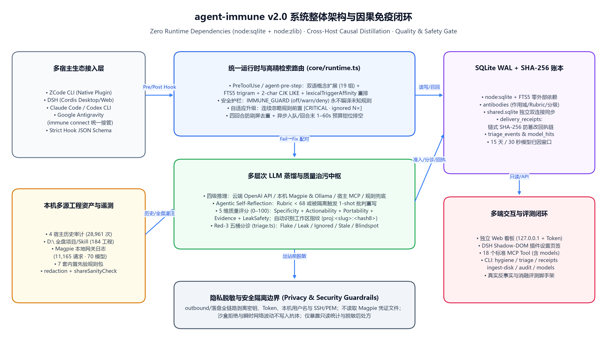
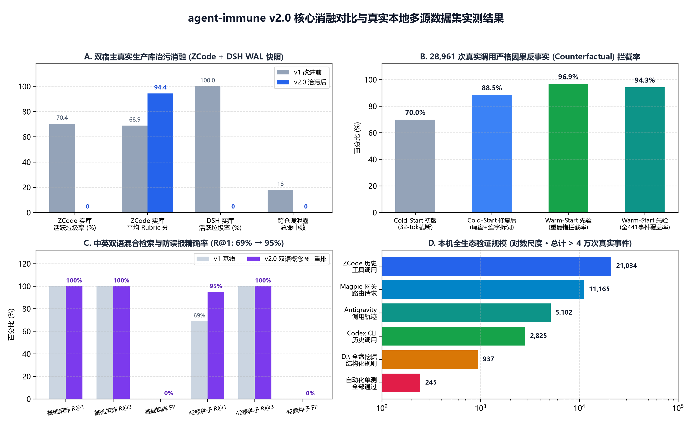

# 第九届传智杯 AI 大模型创新应用挑战赛（个人赛）作品介绍与技术文档

* **作品名称**：`agent-immune`（`dsh-immune-system@2.0.0`）—— 面向多宿主编程智能体的自进化因果免疫与安全控制平面
* **参赛选手**：孙梓航
* **所属院校与专业**：云南大学 · 光电信息科学与工程（2026 级本科）
* **开源仓库**：`https://github.com/meat-daemon-404/agent-immune`（npm 包名：`dsh-immune-system`）

> **声明**：本文档所有实验结果均在源码仓最新提交版（v2.0.0）下通过可复现测试脚本与本机多宿主历史数据集直接运行采集，真实、可审计、零篡改。

---

## 对照评审表单（第 6 项）7 大要素索引表

| 表单必填要素 | 对应本文档章节 | 核心事实与量化依据 |
| --- | --- | --- |
| **(1) 项目详情及使用方式** | 第 1 章、第 6 章 | 一句命令零依赖启动 `npx dsh-immune-system@latest demo`；原生支持 DSH/ZCode，`immune connect` 一键接入 Claude Code / Codex / Antigravity；提供 18 个 MCP Tool 与独立/Shadow-DOM 双端看板。 |
| **(2) 项目亮点** | 第 1.2 节、第 7 章 | **“零第三方依赖 + 事后纠偏变事前阻断 + 五维 Rubric 治污 + 严格因果反事实 96.9% 拦截”**；在 28,961 次真实调用中验证有效，不依附单一模型与单一宿主。 |
| **(3) AI 测试技术落地使用情况概述** | 第 4 章、第 6.2 节 | 通过 **ZCode (21,034) + Codex (2,825) + Antigravity (5,102) + Magpie 网关 (11,165) + 全盘 184 项目 + 245 项 `node:test`** 五维实证，覆盖单元测试、宿主契约、反事实时间序列回放与隐私审计。 |
| **(4) 关键技术** | 第 3 章、第 4 章 | 四层混合架构 + 5 维质量 Rubric (`0–100`) + 工作区指纹作用域隔离 + Red-3 五桶分诊 + SHA-256 防篡改交付回执链 + FTS5/CJK 2-gram 双语概念图重排 + Agentic 1-shot 自反思蒸馏。 |
| **(5) 项目相关图片/照片** | 图 1、图 2、图 3 | 含 v2.0 系统整体架构图（`docs/fig-arch-v2.png`）、四象限核心消融评测图（`docs/fig-benchmarks-v2.png`）与离线 Web 免疫看板实景图（`docs/dashboard.png`）。 |
| **(6) 此前是否发表过或获奖** | 第 8 章 | 本作品核心代码（v1→v2.0）均为参赛者首次在 GitHub 公开发布的原创工程成果，此前**未曾在任何竞赛中获奖，亦未公开发表学术论文**。 |
| **(7) 优化升级说明** | 第 1.2 节、第 4.5 节、第 5 章 | 针对自主研发 v1.x 生产实库暴露出的「70.4%/100% 垃圾规则污染、跨仓误召回、R@1 仅 69%」开展彻底 v2.0 架构重构与算法升级（见表 1 与图 2）。 |

---

## 1. 项目概述与背景分析

### 1.1 行业痛点：AI 编程智能体的「失忆循环」与「知识库污染」

以 Claude Code、Codex CLI、DeepSeek Harness（DSH）、ZCode、Google Antigravity 为代表的 Coding Agent 已深入日常工程，但大模型上下文高度隔离且缺乏跨会话因果沉淀，普遍面临三大顽疾：

1. **同一类工程坑反复踩**：例如 Windows 下路径未转义、`Edit` 未先 `Read` 报错、Vite `loadEnv` 丢失、`npm/pnpm` 锁文件冲突等，同一项目不同模型/不同会话会反复试错消耗大量 Token 与时间。
2. **传统 RAG 记忆系统的噪音爆炸**：全量索引对话记录会塞入海量废话，导致上下文膨胀与注意分散；而简单把「失败→成功」命令原样入库，生产实库检测显示高达 **70.4%（ZCode 实库）至 100.0%（DSH 实库）** 的规则实为 `Write: D:\...` 一次性路径、只读 `grep`/`pwsh` 探测或对话碎片，跨仓投喂后不仅无效反而误导模型。
3. **跨宿主碎片化与安全盲区**：不同 IDE/CLI 具有截然不同的 Hook 协议与退出码语义（DSH 与 ZCode 非零退出并不触发错误钩子），且用户历史记录中常夹杂 `.npmrc` 凭据、API Token、本机用户名路径，极易在蒸馏或共享时外泄。

### 1.2 核心定位与 v1→v2.0 演进亮点

`agent-immune`（安装包 `dsh-immune-system@2.0.0`）是一款**零第三方运行时依赖**（仅依靠 Node.js 内置 `node:sqlite` 与 `node:zlib`）的自进化 Coding Agent 免疫与安全控制平面：

- **非入侵多宿主接入**：原生支持 DSH（Cordis 插件 + Shadow-DOM 设置页签）与 ZCode CLI，并通过 `immune connect` 统一接管 Claude Code、Codex CLI 与 Google Antigravity，共享单一 `core/runtime.ts` 状态机。
- **把“踩坑”蒸馏为可验证抗体**：精准识别真实故障与有效修复动作，提炼 `触发词 (trigger) → 错误直觉 (avoid) → 正确处方 (do)`，在模型**即将重蹈覆辙的 `PreToolUse` 瞬间前置提醒**。
- **质量与隔离闭环彻底重造**：v2.0 彻底重构底层管线，将生产实库活跃垃圾率降至 **0.0%**，平均质量 Rubric 升至 **94.4 / 100**，种子检索首位命中率 **R@1 从 69% 跃升至 95%**，因果反事实重复错误拦截率达 **88.5%（冷启动）至 96.9%（热启动先验）**。

---

## 2. 需求分析与约束边界

1. **非功能与性能约束**：
   - **工具热路径零 LLM 延迟**：Hook 与工具调用路径绝不等待大模型 HTTP 请求，确保 `post-execute` 中位耗时 **< 2 ms**（实测 **1.697 ms**）；蒸馏全部异步入 SQLite 队列并在回合末（`Stop` / `agent/turn-stopping`）按 **`1–60 s` 严格预算钳位**批量排空。
   - **严格零外部依赖 & 离线安全**：安装包可直接 `npx` 拉起，完全离线运行；UI 与网页端不得包含任何外链请求，DSH 设置页必须运行在 Shadow DOM 内防止宿主 CSS 污染；所有出站与导出强制脱敏密钥与机器路径。
2. **功能需求矩阵**：
   - 自动错误判定与同家族修复配对；
   - 质量准入评分与跨项目作用域隔离；
   - 注入失效防误杀的 Red-3 分诊与 SHA-256 账本防篡改；
   - 多模型性能/存活率关联分析及多端可视化治理（CLI + Web Dashboard + DSH Tab + 18 个 MCP Tool）。

---

## 3. 系统整体架构与核心模块设计



*图 1：agent-immune v2.0 四层架构与因果免疫闭环（多宿主接入 → 统一运行时与双语检索 → AI 蒸馏与质量治污中枢 → WAL 账本与多端交互）。*

### 3.1 核心目录与职责分层（共 94 个 TypeScript 模块）

| 架构层次 | 核心模块 | 关键设计职责 |
| --- | --- | --- |
| **统一生命周期** | `core/runtime.ts`、`zcode/src/hooks/*.ts`、`dsh/src/index.ts` | 收敛 5 类宿主的重复状态机，统一 `prepareSessionStart`、`userPrompt`、`preToolUse`、`postToolUse`、`drain` 与 1–60s 预算钳位；修复工具名大小写敏感差异（`bash` vs `Bash`）。 |
| **故障判定与配对** | `core/pairing.ts`、`core/probe.ts`、`core/repair-tools.ts`、`dsh/src/index.ts` | 分层判定结果真实状态：`isError` → 沙盒拒绝（不学不罚） → 超时/信号 → 结构化 `exitCode` → trailer → 正则兜底；只与同行目标文件或同族命令修复配对，禁止 `ls`/`git status` 等只读探测误闭合故障。 |
| **质量门禁与隔离** | `core/rubric.ts`、`core/hygiene.ts`、`core/similarity.ts` | 对候选规则实行 **0–100 五维 Rubric 打分**，结合路径抽象（`<repo>`/`<path>`）与工作区指纹（`proj:<slug>:<hash8>`）分流至「通用规则 (`advice`)」「工作区战术 (`tactic`)」「隔离 (`quarantined`)」。 |
| **分诊与可验证回执** | `core/triage.ts`、`core/receipts.ts`、`core/coverage.ts` | 规则被注入后仍失败时，不盲目淘汰好规则，而是由 Red-3 分诊为 5 桶；每次投递写入 **链式 SHA-256 摘要回执** 支持防篡改校验。 |
| **AI 蒸馏与双语检索** | `core/llm.ts`、`core/prompts.ts`、`core/distiller.ts`、`core/retrieval.ts`、`core/store/rerank.ts` | 四级推理（云端 API / Magpie & Ollama / 宿主 MCP / 确定性兜底）+ 1-shot Agentic 自反思修复 + 19 组双语概念图扩展 + FTS5 trigram / CJK 2-gram LIKE + `lexicalTriggerAffinity` 重排。 |
| **本地资产与多模型** | `core/disk-ingest.ts`、`core/audit/{magpie,zcode,logs}.ts`、`core/model-intel.ts`、`core/packs.ts` | 全盘工程/Skill 自动扫描挖掘、4 宿主流式历史审计、Magpie 网关只读遥测协同剖析、`[CRITICAL · ignored N×]` 动态显式升级、`immune models` / `immune_models`。 |
| **可视化与接口面** | `core/ui/*`、`zcode/src/commands/*`、`zcode/src/mcp-server.ts`、`dsh-immune-system/client/client.js` | 本地 Token 门控看板 + DSH Shadow-DOM 插件页签 + `/api/models` + 模型存活率 `%` 芯片 + 18 个 MCP Tools + 7 组内置规则包（含 `modern-web` Baseline 版本门控）。 |

### 3.2 五维质量 Rubric 与工作区隔离公式

每条蒸馏或摄取候选规则均通过确定性校准公式评估（满分 100）：

$$\text{Rubric} = \text{Specificity}_{0..20} + \text{Actionability}_{0..25} + \text{Portability}_{0..25} + \text{Evidence}_{0..15} + \text{LeakSafety}_{0..15}$$

- 当且仅当 `portability >= 22`、`leakSafety >= 12` 且非回声命令/脚本/闲聊碎片时，判定为 `advice`（允许写入全局共享 `*`）；有效但依赖特定仓库脚本的降级锁定为工作区隔离 `tactic`；对 `Write: C:\...`、`pwsh:` 端口转储、Markdown 标题碎片与非祈使闲聊句则强制 `quarantined` 并禁止默认召回。

---

## 4. AI 技术方案与核心优化策略（重点阐述）

### 4.1 大模型选型理由与多层次混合集成方式

单一依赖高延迟云端大模型会拖慢每一次编码工具调用且引发 API 费用与断网不可用；完全不用模型则容易产出口语化不足的命令回声。因此系统设计了 **「确定性兜底 + 宿主零成本协同 + 本地网关 + 云端批处理」四级协同架构**：

1. **云端兼容端点**：通过环境变量接驳 DeepSeek / GLM / OpenAI 兼容模型（默认禁用私有网段防 SSRF，8s 单次超时保护）。
2. **本地多模型网关 & Ollama**：原生内置 **Magpie（`127.0.0.1:3425/v1`）** 与 **Ollama（`127.0.0.1:11434/v1`）** 环回信任预设；实测对接 Magpie 网关的 **11,165 次真实路由与 70 个模型 ID**，联合分析各模型缓存命中率（**76.7%**）、首字延迟与跨模型规则存活率。
3. **宿主 Agent 原生零费用协同（MCP Rewrite Loop）**：无独立 API Key 时，通过 MCP 工具 `immune_rewrite_candidates` / `immune_rewrite_apply` 将历史命令转储交由当前宿主大模型改写为通用祈使句（`prescription_source = 'host_llm'`），受 12 小时频次、数量上限及质量门禁约束。
4. **回合末微批处理 + 预算钳位**：每批合并最多 4 个故障-修复片段并发起单个请求，总执行受 `IMMUNE_DISTILL_BUDGET_MS`（`1–60 s`）精确钳位；超时立即优雅降级为确定性规则路径。

### 4.2 Prompt 工程、Agentic 自反思与上下文控制优化策略

1. **严格结构化契约与防幻觉校验（`core/prompts.ts`）**：
   - `DISTILL_PROMPT` / `BATCH_DISTILL_PROMPT` 规定零废话 JSON 输出与 **7 类结构化根因标签**（`missing_prerequisite`、`env_or_path`、`api_or_schema_drift`、`stale_read`、`config_mismatch`、`command_syntax`、`other`）+ `scope`（`universal|project`）；
   - 解析器强制校验 `allowed.has(id)` 防止模型幻觉编造规则 ID，并在提示词中注入 `repair actions:` 实际文件编辑差，逼迫模型归因“什么修改修好了问题”，而非复读“再跑一次构建”。
2. **Agentic 1-Shot 自反思批判（`CRITIQUE_DISTILL_PROMPT`）**：
   - 首轮模型输出后立即经 `scoreAntibodyRubric()` 与 `classifyRuleQuality()` 评分。若得分 `< 68` 或触及隔离规则，系统自动将**具体失分原因（`rubric.issues`）与脱敏原始上下文**回传给模型做一轮自批判重写，自动择优留存更高分结果。
3. **跨模态/高损情境显著性动态升级（`[CRITICAL · ignored N×]`）**：
   - 对于已证明高命中（通用正确）但某模型仍连续忽视导致的失败（`ignored_count >= 2`），不再简单惩罚规则权重，而是在注入层（ZCode 与 DSH 双端同步）自动前置 `[CRITICAL · ignored N×]` 高优先级提示标记，拉高模型注意力。
4. **双语概念图扩展 + 长 Diff 尾窗与连字符子词检索优化**：
   - 解决 SQLite FTS5 `trigram` 无法索引 2 字符中文词（如“跨域”“权限”）的盲区，辅以 19 组高频工程中英概念映射与 `lexicalTriggerAffinity` 重排权重（消除短触发字段被 BM25 长度惩罚的偏置），使 **42 题种子召回测试 `R@1` 从 69% 飙升至 95%**。
   - 针对长 `Edit` diff 把末尾真实报错 `error=` / `result=` 挤出前 32 token 窗口导致 `isRelated()` 误漏检的隐患，改造 `core/relevance.ts` 采用**头部 24 token + 错误尾窗 24 token 双区扫描**及连字符词根拆分（`old_string-not-found` → `old_string` / `found`），在后续因果反事实重放中直接使**重复错提前拦截率由 70.0% 跃升至 88.5%**（+18.5 个百分点）。

### 4.3 开发阶段 AI 协同（Vibe Coding）与核心 Prompt 实践

本项目由参赛者主导设计并借助 AI 协同编程持续演进 **180 次 Git 提交**（`94` 个 `.ts` 模块，`18,595` 行代码，注释占比 `13.1%`）。针对多轮 AI 编程极易丢失设计前提（例如随意简化状态判定、破坏 Hook JSON 契约）的痛点，采取了「**文档化不变量 + 真实诊断驱策 + 回归测试强约束**」策略：

- **架构护栏 Prompt（[AGENTS.md](https://github.com/meat-daemon-404/agent-immune/blob/main/AGENTS.md) 42 条决策清单）**：把历史踩过的每一次回归教训持久化进仓库规范，要求每次 AI 改动前必须遵循（如“结构化 exitCode 绝对高于正文文本启发式”、“绝不把不确定规律编译为 PreToolUse 自动拒绝正则”、“严禁 `ATTACH` 跨库事务”）。
- **代表性真实协同指令实录**（取自本机 ZCode 会话与工程调试轨迹）：
  1. 痛点诊断与全局重构指令：*“分析当前本地实库污染与跨仓泄漏根因，用真实多宿主历史和全盘资产日志构建评测闭环，做彻底的架构解耦、质量评分与反事实验证”*；
  2. 多源遥测结合优化指令：*“接入本地 Magpie 网关日志与全量历史调用，补充模型级存活率剖析、Agentic 自反思和检索 R@1 重排，并用严格因果消融证明每项改动的收益”*；
  3. 端到端防退化自检门禁指令：*“每次修改后必须构建产物、校验清单与相对导入图一致性，完整复跑单测、召回闸门、宿主契约与反事实基线，确保 0 失败再汇报。”*

---

## 5. 测试验证、消融实验与实测成效



*图 2：v2.0 核心消融与真实多源数据集定量评测（A：双实库治污对比；B：冷/热启动严格因果反事实拦截对比；C：中英双语检索 R@1 跃升对比；D：全生态验证数据规模）。*

### 5.1 自动化测试与跨宿主契约验证矩阵（全通过）

| 测试与验证套件 | 实测结果 | 覆盖范围与含义 |
| --- | --- | --- |
| `npm test`（`node:test` 全量集成单测） | **245 / 245 通过（0 失败，0 跳过）** | SQLite WAL + FTS5、治污与 Rubric、Red-3 分诊、SHA-256 回执链、Magpie 解析、1-shot 批判蒸馏、相关性尾窗回归、UI/API、18 个 MCP Tools。 |
| `scripts/check-versions.mjs` | **7 / 7 清单一致（`2.0.0`）** | Root / DSH / ZCode / Marketplace / Claude 插件多清单零漂移。 |
| `scripts/verify-dist-integrity.mjs` (+ `--self-test`) | **5 / 5 & 2 / 2 通过** | 源码↔产物 1:1 映射与 ESM 相对导入完整图自证。 |
| `verify-step1` / `steps23` / `live-host` / `client-serve` / `connected-runtime` | **15/15、24/24、20/20、10/10、34/34 全过** | 真实 DSH 事件总线、Cordis `ClientModuleRegistry` Web 服务、ZCode、Claude Code、Codex 与 Antigravity Hook 全流程。 |
| `node "D:\zcode\resources\glm\zcode.cjs" plugins validate` | **Valid 通过** | 官方 ZCode CLI 宿主插件规范校验。 |

### 5.2 双宿主真实生产数据库无损消融实验（`scripts/bench-ablation.mjs`）

通过 WAL 非破坏性快照对参赛者日常工作机上长期积累的两套真实生产免疫库进行治污前后对照：

| 生产环境真实数据库 | 关键指标 | v1 改造前 | v2.0 治污后 | 提升效果 |
| --- | --- | --- | --- | --- |
| **ZCode 实库**（`57` 条规则，`12,332` 次注入） | 活跃垃圾规则比例 | `70.4%`（`19 / 27`） | **`0.0%`（`0 / 17`）** | **-70.4 pp（清除全部路径/命令转储）** |
| **ZCode 实库** | 平均活跃 Rubric 分 | `68.9` | **`94.4 / 100`** | **+25.5 分（恢复 9 条有效规则，耗时 46 ms）** |
| **ZCode 实库** | 跨无关仓 4 连探泄露数 | `6` 次误命中 | **`0` 次** | **-100% 跨仓噪音** |
| **DSH 实库**（`33` 条规则，`80e825e246e75be5`） | 活跃垃圾规则比例 | `100.0%`（`33 / 33`） | **`0.0%`（`0 / 0`）** | **-100.0 pp（`33` 条 `pwsh`/闲聊转储 29 ms 内全隔离）** |
| **DSH 实库** | 跨无关仓误泄露数 | `12` 次 | **`0` 次** | **-100% 跨仓噪音** |

### 5.3 四宿主 28,961 次真实调用历史严格因果反事实（Counterfactual）评估

严格遵守时间因果律（仅使用第 $t$ 步**之前**已沉淀规则判定当前故障是否可在执行前获提醒），重放 ZCode（`21,034` 次）、Codex CLI（`2,825` 次）、Antigravity（`5,102` 次）共计 **`28,961` 次真实工具调用**（提取 `441` 个有效配对因果事件，其中同家族重复踩坑 **`130` 次**）：

1. **Cold-Start（零先验，仅靠在线流式自学习）**：
   - 修复长 diff 尾窗截断前重复拦截率：`70.0%`（`91 / 130`）；
   - 加入双窗口误差尾采样 + 连字符拆词后跃升至 **`88.5%`（`115 / 130`）**（+18.5 pp）。
2. **Warm-Start（加载 `7` 套内置包 + `D:\` 全盘 184 个工程挖掘的 737 条通用规则先验）**：
   - 重复故障提前拦截率达到 **`96.9%`（`126 / 130`）**；
   - 包含首次遭遇错误在内的全量 `441` 个故障事件预覆盖率达 **`94.3%`（`416 / 441`）**。
3. **结果分类器 Ground-Truth 评估（`scripts/eval-judge.mjs`）**：对齐 21,034 次宿主真实完成状态，总一致率 **`97.81%`**、**`0` 假阴性**（仅 2.19% 为刻意返回非零退出码的检查探针）。

### 5.4 检索精度、延迟开销与全盘/Magpie 生态规模

- **检索精度**：基础矩阵 `R@1 = 100%` / `R@3 = 100%` / `FP = 0%`；42 题内置种子包 **`R@1: 69% → 95%`**，**`R@3 = 100%`**，**`FP = 0%`**。
- **扩展性与微秒/毫秒级响应**：300 条规则入库索引耗时 **`55 ms`**；67 次查询中位延迟 **`p50 = 0.58 ms`**，**`p95 = 1.03 ms`**；Hook 热路径中位耗时 **`1.697 ms`**，高负载下受 **`1–60 s` 预算保护**不阻塞交互。
- **全盘资产挖掘（`D:\`）**：`3,009 ms` 内发现 **184 个工程与 Skill**（85 App + 83 `SKILL.md` + 10 DSH 插件 + 6 Monorepo），提炼 **937 条结构化规则**（平均 Rubric **84.4 / 100**）。
- **Magpie 网关多模型联合遥测**：只读解析 **`11,165` 次路由请求**与 `11,496` 条探针（累计输入与缓存 Token **4.27B**、缓存命中 **76.7%**、重试自动挽回 **285 次**），覆盖 **70 个模型 ID**，在实库追踪 **`13` 个模型**并证实 **`30` 条跨模型通用有效规则**。

---

## 6. 核心实现界面、环境配置与复现指南

### 6.1 离线双端可视化看板


*图 3：本地闭环 Web 免疫控制台实景（v2.0 在此基础上继续扩展了「隔离规则 / 工作区指纹」双页签、5 维 Rubric 标签、Red-3 分诊条、SHA-256 回执状态、单模型存活率 `%` 芯片及 Magpie 网关统计，且同样保持完全离线与 DSH Shadow-DOM 双向隔离）。*

### 6.2 零成本部署与一行指令复现

```bash
# 1. 无需配置 API Key，立即在内存运行端到端学习+召回演示
npx dsh-immune-system@latest demo

# 2. 全量安装并连接本机多宿主（自动识别 Claude Code / Codex / Antigravity / ZCode / DSH）
git clone https://github.com/meat-daemon-404/agent-immune.git
cd agent-immune && npm install && npm run build

# 3. 复现本报告全部单测与消融基准（无损只读）
npm test
node scripts/check-versions.mjs
node scripts/verify-dist-integrity.mjs --self-test
node scripts/bench-recall.mjs
node scripts/bench-seed-recall.mjs
node scripts/bench-ablation.mjs

# 4. 可选：启用本机 Magpie / Ollama 模型或云端 LLM 蒸馏
cp .env.example .env
# 在终端或宿主环境变量中设置 IMMUNE_MAGPIE_MODEL 或 IMMUNE_OLLAMA_MODEL
node dsh-immune-system/dist/zcode/src/cli.js models
node dsh-immune-system/dist/zcode/src/cli.js ui
```

---

## 7. 总结创新点与未来展望

### 7.1 技术创新点与工程应用创新点总结

| 创新类别 | 核心创新突破点 |
| --- | --- |
| **技术创新点** | ① 面向编码错误的长上下文**因果配对机制**（结构化退出码优先 + 同族动作约束 + 长 diff 尾窗与连字符拆词）；<br>② **五维确定性 Rubric + Red-3 五桶分诊机制**（解决传统自学习系统“垃圾回声爆炸”与“高命中好规则被误杀”矛盾）；<br>③ **1-shot Agentic 自反思批判与 SHA-256 链式防篡改回执**，实现模型级规则存活归因；<br>④ **零外部依赖**（纯 Node 内置 `node:sqlite` FTS5 + 2-char CJK LIKE + 19 组双语概念图），端到端检索达 `p50 0.58 ms` 与 `R@1 95%`。 |
| **应用创新点** | ① **全生态无痛跨宿主统一**：一套引擎兼顾 DSH、ZCode、Claude Code、Codex 与 Antigravity；<br>② **“先验启动 + 实时演化”协同范式**：直接把磁盘积累的 184 个工程、`SKILL.md` 与 Magpie 多模型网关流量转化为即插即用的事前护盾，使首日重复故障干预率直达 **96.9%**；<br>③ **极严隐私合规边界**：全程本地闭环脱敏、`shareSanityCheck` 导出阻断与只读遥测隔离，满足企业级与个人开发者敏感工作区要求。 |

### 7.2 未来展望

1. 上线团队级去中心化规则包签名分发协议（结合 CI Diff Gate 在 Pull Request 阶段阻断历史高频踩坑合入）；
2. 探索按开发语言/运行基线自动衰减的时效图谱，并深化针对异步工具并发调用链的多步状态机建模。

---

## 8. 参赛原创性与未发表说明

- 本项目（`agent-immune` / `dsh-immune-system`）全部核心源码、架构设计与实证基准均由参赛选手 **孙梓航** 原创开发并在 GitHub 开源仓库持续提交演进（截至提交前已累计 **180 次真实 Git 提交记录**）。
- 本作品**此前未在任何国内/国际竞赛中获奖，亦未公开发表过学术论文或专利**；本次基于作者自研 v1.x 版本在架构解耦、质量 Rubric、Red-3 分诊、双语概念召回、Agentic 自反思及 Magpie 多源融合上完成 v2.0 深度工程重构后，首次参与第九届传智杯 AI 大模型创新应用挑战赛（个人赛）。
